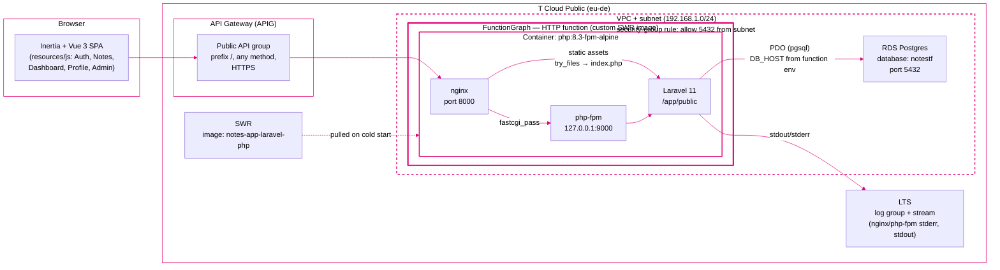

# fg-notesapp-laravel-php

Example on how to host a 3-tier web application on **T Cloud Public** FunctionGraph: the presentation tier is an Inertia + Vue 3 single-page app, the application tier is a [Laravel](https://laravel.com/) (PHP 8.3) backend, and the data tier is a managed PostgreSQL database (RDS).

The app lets users create, edit, search, pin, and delete notes, with authentication and per-user access control.


## Contents

- [What Is Demonstrated](#what-is-demonstrated)
- [Overview](#overview)
- [Development Environment](#development-environment)
- [Deploy to FunctionGraph via Console](#deploy-to-functiongraph-via-console)
  - [Prerequisites](#prerequisites)
    - [Resources on T Cloud Public](#resources-on-t-cloud-public)
    - [Local PC - Environment variables](#local-pc---environment-variables)
  - [Build and Push Docker Image](#build-and-push-docker-image)
  - [Configure FunctionGraph](#configure-functiongraph)
    - [Basic Settings](#basic-settings)
    - [Triggers](#triggers)
    - [Permissions](#permissions)
    - [Network](#network)
    - [Environment Variables](#environment-variables)
    - [Logs](#logs)
    - [Advanced Settings](#advanced-settings)
- [Deploy to FunctionGraph with Terraform](#deploy-to-functiongraph-with-terraform)
  - [Configuration](#configuration)
  - [Deploy](#deploy)
  - [Update FunctionGraph Code](#update-functiongraph-code)
  - [Update Terraform Deployment Without Pushing a New Image](#update-terraform-deployment-without-pushing-a-new-image)

## What Is Demonstrated

- creating a FunctionGraph HTTP function running a custom container image
- hosting a complete web application (Laravel + Inertia + Vue 3) in a FunctionGraph function
- building and pushing a multi-stage container image to SWR
- exposing the function through an API Gateway (APIG) trigger with a public HTTPS URL
- VPC networking: the function accessing a managed RDS PostgreSQL database
- IAM agency granting the function access to SWR and the VPC
- shipping function logs to Log Tank Service (LTS)
- running a stateful application on stateless function instances: database-backed sessions and cache, idempotent database migrations on cold start
- deploying the infrastructure with Terraform and updating the function image via the FunctionGraph REST API

## Overview



**Request flow.** The browser talks only to the public API Gateway URL; APIG routes every request (prefix `/`) to the FunctionGraph HTTP function. Inside the function, a single container (built by the multi-stage `docker_nginx/Dockerfile_nginx`: a `composer` stage for `vendor/`, a `node` stage for the compiled frontend in `public/build`, and a `php:8.3-fpm-alpine` runtime) runs `supervisord`, which starts **nginx on port 8000** and **php-fpm on 127.0.0.1:9000**. nginx serves the compiled SPA and static assets directly from `/app/public` and proxies `.php` requests to php-fpm, which runs the Laravel application.

### HTTP endpoints

All endpoints are served by the single FunctionGraph function under the public API Gateway URL (there is no separate REST API; the browser is the only client). Inertia pages (GET) return HTML, all other routes return HTTP redirects.

- **GET /**  
  Redirects to the login page.

- **GET /login, POST /login**  
  Login page and credential submission.

- **GET /register, POST /register**  
  User registration.

- **GET /forgot-password, POST /forgot-password**  
  Password reset request (sends the reset link email).

- **GET /reset-password/{token}, POST /reset-password**  
  Set a new password.

- **POST /logout**  
  Ends the session.

- **GET /dashboard**  
  Dashboard with the user's overview (authenticated + verified).

- **GET /notes**  
  List of the user's notes, with search.

- **GET /notes/create, POST /notes**  
  Create a note.

- **GET /notes/{note}/edit, PUT|PATCH /notes/{note}, DELETE /notes/{note}**  
  Edit or delete a note (owner only).

- **PATCH /notes/{note}/pin**  
  Pin/unpin a note.

- **GET /profile, PATCH /profile, DELETE /profile**  
  View, update, or delete the user profile (account deletion requires confirmation).

- **GET /verify-email, GET /verify-email/{id}/{hash}, POST /email/verification-notification**  
  Email verification.

- **GET /confirm-password, POST /confirm-password**  
  Re-confirm the password before sensitive actions.

- **PUT /password**  
  Change the account password.

- **GET /admin/users, DELETE /admin/users/{user}**  
  Admin-only user list and user deletion.

**Frontend.** The UI is an Inertia + Vue 3 single-page app: the initial HTML comes from Laravel, and subsequent page changes (login, notes, dashboard, profile, admin) are handled client-side by Inertia, so only one Laravel route entry point is needed.

**Database.** Laravel connects to the RDS PostgreSQL instance (`notestf`) over the VPC: the function runs in the user's VPC/subnet, and an inbound security-group rule on the RDS security group allows TCP/5432 from that subnet. Connection details (`DB_HOST`, `DB_DATABASE`, `DB_USERNAME`, and `DB_PASSWORD` in the function's encrypted env) are passed to the function as environment variables.

**State and sessions.** The container is stateless: sessions and the cache are stored in the database (`SESSION_DRIVER=database`, `CACHE_STORE=database`), and compiled view/config/route caches go to `/tmp`. On cold start, `entrypoint-nginx.sh` runs `artisan migrate` (idempotent) and `artisan optimize` before handing over to supervisord.

**Supporting services.**

- **SWR** — stores the container image; FunctionGraph pulls the tagged image on cold start.
- **LTS** — the function's `stdout`/`stderr` (nginx access/error logs and PHP logs) are shipped to a Log Tank group/stream.
- **IAM agency** — grants the function `SWR Administrator` (to pull the image) and `VPC FullAccess` (to use the network).
- **OBS** — used as the Terraform state backend.


## Development Environment

This sample was written using WSL2 and Ubuntu-22.04 distribution but might also work on other Linux versions.

The used IDE is vscode,

Additional software needed:
- Docker

For further setup see [README_SETUP.md](./README_SETUP.md).


## Deploy to FunctionGraph via Console

### Prerequisites

#### Resources on T Cloud Public

Following resources must exist on T Cloud Public in the same VPC and Subnet:
- RDS (Postgres Database)
- API Gateway
- SWR (Software Repository for Container)

#### Local PC - Environment variables

Set following environment variables:

| Variable             | Description                   |
| -------------------- | ----------------------------- |
| OTC_SDK_PROJECTNAME  | Project Name (Same as Region) |
| OTC_SDK_AK           | Your access key               |
| OTC_SWR_LOGIN_KEY    | see below                     |
| OTC_SWR_ENDPOINT     | see below                     |
| OTC_SWR_ORGANIZATION | see below                     |

For SWR variables, see: [Obtaining a Long-Term Valid Login Command for SWR](https://docs.otc.t-systems.com/software-repository-container/umn/image_management/obtaining_a_long-term_valid_login_command.html#swr-01-1000)


### Build and Push Docker Image

Check and adapt [Makefile](./Makefile).

In project root execute

```bash
make docker_push
```

### Configure FunctionGraph

Create Function as **Container Image** -  **HTTP Function**

- Region: your region
- Function name: your function name
- Enterprise project: default
- Agency: see below
- Container Image:  notes-app-laravel-php:${IMAGE_TAG}

#### Basic Settings

- Enterprise Project: default
- Execution Timeout: 300
- Memory: 256

#### Triggers

API Gateway Trigger:

- API Group: APIGroup_php_notes_app
- Environment: RELEASE
- Security Authentication: NONE
- Matching: Prefix match
- Method: Any
- Protocol: HTTPS
- Path: /
- Timeout: 60000 ms

> The API Gateway URL may resolve to a private IP. If the APIG environment is
> exposed internally only, the trigger URL is reachable from inside the VPC
> only; from outside you get a connection *timeout*, not an HTTP error. Enable
> Public Inbound Access in the APIG Console if the app needs
> to be publicly accessible.

#### Permissions

An agency with following permissions is needed:

- SWR Administrator
- VPC FullAccess

#### Network

- VPC Access: enabled
- VPC: same as RDS database / SWR / APIG
- Subnet: same as RDS database / SWR / APIG

> The RDS instance's security group must also allow inbound TCP 5432 from the subnet CIDR (e.g. `192.168.1.0/24`).
> FunctionGraph functions get *ephemeral* IPs from the subnet pool and are **not**
> members of the RDS security group, so without this rule the function cannot
> connect (symptom: `port 5432 failed: timeout expired` in the function logs).
> Add the rule manually under VPC → Security Groups → (RDS SG) → Inbound Rules:
> protocol TCP, port 5432, remote = subnet CIDR, action Allow.

#### Environment Variables

The Docker image does not contain the app's `.env` file (excluded via `.dockerignore`); all runtime configuration is taken from these environment variables.

| Key              | Value            | Description                                              | Required | Encrypted |
| ---------------- | ---------------- | -------------------------------------------------------- | -------- | --------- |
| DB_CONNECTION    | pgsql            | Use Postgres (default in image)                          | no       |           |
| DB_HOST          | YOUR DB HOST     | Database host                                            | yes      |           |
| DB_PORT          | 5432             | Database port (default in image)                         | no       |           |
| DB_DATABASE      | notes            | Database name                                            | yes      |           |
| DB_USERNAME      | root             | Database user name                                       | yes      |           |
| DB_PASSWORD      | *****            | Password for DB User                                     | yes      | yes       |
| APP_KEY          | *****            | Laravel encryption key, see [README_SETUP.md](./README_SETUP.md) | yes      | yes       |
| APP_URL          | URL              | API Gateway URL, see Trigger                             | no       |           |
| RUN_MIGRATIONS   | true             | Run `artisan migrate` on function start (default in image); set to `false` to skip | no |           |
| ADMIN_EMAILS     | email1           | Comma separated list of admin email addresses            | no       |           |

> With `RUN_MIGRATIONS=true`, `php artisan migrate` runs on *every* cold start.
> It is idempotent and safe, but adds a few seconds to cold starts — set it
> back to `false` once the schema is in place.

#### Logs

- Collect Logs: enabled
- Log Group: specify your log group
- Log Stream specify your log stream

#### Advanced Settings

- Dynamic Memory: enable
- Include Keys: enable


## Deploy to FunctionGraph with Terraform

You can deploy the project using Terraform.

Following resources must exist on T Cloud Public in the same VPC and Subnet:
- RDS (Postgres Database)
- API Gateway
- SWR (Software Repository for Container)

### Configuration

1. Create a `terraform/variables.auto.tfvars` (git-ignored, auto-loaded by Terraform on every run) and set following values:

    ```bash
    # API Gateway instance ID
    API_GATEWAY_INSTANCE_ID =
    # VPC ID
    VPC_ID =
    # Subnet ID 
    NETWORK_ID = 
    # Database name, e.g. notestf
    DB_DATABASE = "notestf"
    # RDS Host
    DB_HOST = 
    # Port of RDS
    DB_PORT = "5432"
    # db user
    DB_USERNAME = "root"
    # Password of db user 
    DB_PASSWORD = 
    # Laravel APP KEY
    APP_KEY = 
    # comma separated list of admin user emails
    ADMIN_EMAILS = "admin@company.com"    
    ```

2. Adapt [terraform/provider.tf](./terraform/provider.tf) (bucket, key, and region in the `backend` configuration)

3. Adapt [MakefileTF](./MakefileTF)

    ```make
    # Terraform backend configuration
    # bucket for tf states
    BACKEND_CONFIG_BUCKET := 
    # key for tf state, e.g. "terraform_state/php/fg-notesapp-laravel-php.tf"
    BACKEND_CONFIG_KEY := 
    # Region e.g. "eu-de"
    BACKEND_CONFIG_REGION := "eu-de"
    # obs endpoint
    BACKEND_CONFIG_ENDPOINTS := "endpoints={s3=\"https://obs.eu-de.otc.t-systems.com\"}"
    ```

4. Ensure following environment variables are set:

    | Variable                         | Description                                                                                       |
    | -------------------------------- | --------------------------------------------------------------------------------------------------- |
    | OTC_SDK_AK                       | Access key (also used as `AWS_ACCESS_KEY_ID` for the OBS backend)                                  |
    | OTC_SDK_SK                       | Secret key (also used as `AWS_SECRET_ACCESS_KEY` for the OBS backend)                              |
    | OTC_DOMAIN_NAME                  | IAM domain name                                                                                     |
    | OTC_SDK_PROJECTID                | Project ID                                                                                          |
    | OTC_SDK_PROJECTNAME              | Project name (same as region)                                                                       |
    | OTC_SWR_ENDPOINT                 | SWR endpoint, e.g. `swr.eu-de.otc.t-systems.com`                                                    |
    | OTC_SWR_ORGANIZATION             | SWR organization (repository namespace)                                                             |
    | AWS_REQUEST_CHECKSUM_CALCULATION | `when_required` — needed for Terraform version > 1.11.1 (*)                                        |
    | AWS_RESPONSE_CHECKSUM_VALIDATION | `when_required` — needed for Terraform version > 1.11.1 (*)                                        |

        
    (*) see: [Remote State OBS](https://community.open-telekom-cloud.com/community?id=community_question&sys_id=1207be61138086d0d15a246ea6744162&view_source=searchResult), [AWS CLI supported environment variables](https://docs.aws.amazon.com/cli/v1/userguide/cli-configure-envvars.html#envvars-list)

`MakefileTF` derives `AWS_ACCESS_KEY_ID` / `AWS_SECRET_ACCESS_KEY` (for the
OBS backend) and the provider's `TF_VAR_OTC_SDK_*` variables from the
`OTC_SDK_*` environment variables, so a shell with `.env` loaded is
enough.

> The RDS security-group rule (see the [Network](#network) note above) is
> managed automatically by `terraform/rds_sg_rule.tf`: a data source finds
> the RDS instance (and its security group) in the function's VPC and an
> `opentelekomcloud_vpc_secgroup_rule_v3` resource manages the rule
> idempotently. A rule created in the console first can be adopted with
> `terraform import opentelekomcloud_vpc_secgroup_rule_v3.rds_ingress_rule <rule_id>`.
> It also guards `DB_HOST`: the RDS list API cannot filter by host, so the
> instance's private FQDN is compared against `DB_HOST` at plan time. On a
> mismatch (wrong instance or typo in `DB_HOST`) the plan shows a
> `DB_HOST-MISMATCH …` sentinel instead of the real security-group id and
> `RDS_HOST_MATCH` flips to `false`; applying then fails on the create step
> without touching the existing rule.

### Deploy
To deploy use:

```bash
make -f MakefileTF tf_apply
```

> A persistent `encrypted_user_data` diff in the plan is normal: the provider
> re-encrypts the sensitive env vars (DB_PASSWORD, APP_KEY) on every apply and
> the API stores its own ciphertext, so `terraform plan` always shows the
> function "will be updated in-place" even when nothing changed. The effective
> configuration is unchanged and the app is not affected.

### Update FunctionGraph code

To update FunctionGraph code with image use:

```bash
make -f MakefileTF update_fg_image
```

This builds and pushes a new image (`docker_push`), then updates the function's
image via the FunctionGraph REST API. The API call authenticates with an IAM
username/password token fetched by `utils/tokenFromUsername.sh`, so in addition
to the variables for the Terraform targets, set:

| Variable          | Description                                                    |
| ----------------- | -------------------------------------------------------------- |
| OTC_USER_NAME     | IAM user name used for password authentication                 |
| OTC_USER_PASSWORD | Password of that IAM user                                      |
| OTC_DOMAIN_NAME   | IAM domain name (e.g. `default`)                               |
| OTC_IAM_ENDPOINT  | IAM endpoint, e.g. `https://iam.eu-de.otc.t-systems.com/v3`    |
| OTC_SDK_PROJECTID | Project ID (already needed by the Terraform targets)           |
| OTC_SDK_REGION    | Region, e.g. `eu-de` (used in the FunctionGraph API URL)       |

`utils/tokenFromUsername.sh` falls back to `TF_VAR_`-prefixed versions of these
variables (e.g. `TF_VAR_OTC_USER_NAME`) and needs `jq` on the PATH.

> This target updates the *running function only* — the Terraform state still
> points at the previous image, so the next `tf_plan`/`tf_apply` would roll the
> function back. After using it, re-sync the state with
> `make -f MakefileTF tf_apply IMAGE_TAG=<the tag that was just pushed>`.
> Alternatively, update the image via `tf_apply` with the `IMAGE_TAG` override
> directly (no extra credentials needed).

### Update Terraform Deployment Without Pushing a New Image

If the change is Terraform configuration only, no new image is needed:

```bash
make -f MakefileTF tf_apply_no_push
```

Unlike `tf_apply`, this builds and pushes nothing: it reads the image URL
currently deployed out of the Terraform state and applies the configuration
against it, so the function's image stays unchanged. An existing state is
required — run `make -f MakefileTF tf_apply` first if the function has not
been deployed yet.

> Warranty Disclaimer
> -------------------
> THE SOFTWARE IS PROVIDED “AS IS”, WITHOUT WARRANTY OF ANY KIND, EXPRESS OR IMPLIED,
> INCLUDING BUT NOT LIMITED TO THE WARRANTIES OF MERCHANTABILITY, FITNESS FOR A 
> PARTICULAR PURPOSE AND NONINFRINGEMENT. 
> IN NO EVENT SHALL THE AUTHORS OR COPYRIGHT HOLDERS BE LIABLE FOR ANY CLAIM,
> DAMAGES OR OTHER LIABILITY, WHETHER IN AN ACTION OF CONTRACT, TORT OR OTHERWISE, 
> ARISING FROM, OUT OF OR IN CONNECTION WITH THE SOFTWARE OR THE USE OR OTHER
> DEALINGS IN THE SOFTWARE.
